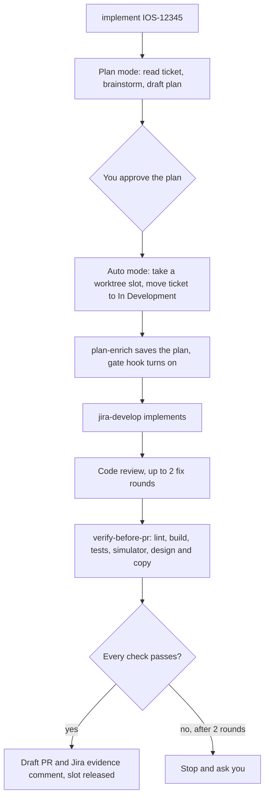

# adit-mobile-orchestration


A set of Claude Code skills, two hooks and one rules block that take an iOS ticket from `implement IOS-12345` to a verified draft pull request. A person only steps in at the plan approval and when something is genuinely blocked.

The repo also holds the install tooling, so you can hand this link to Claude or Codex and let it set everything up.


## Install

The repo is private. You need read access to it and, for the full ticket flow, to the `gdncomm/agent-plugins` marketplace.

The quickest way is to ask your agent:

> Install https://github.com/gdncomm-aditya-h/adit-mobile-orchestration by following INSTALL.md in that repo.

To do it yourself:

```bash
git clone git@github.com:gdncomm-aditya-h/adit-mobile-orchestration.git
cd adit-mobile-orchestration
python3 install.py install --dry-run          # lists every change, makes none
python3 install.py install --prefix yourname  # yourname becomes the branch prefix, e.g. yourname/bugfix/IOS-123
python3 install.py doctor                     # checks the result
```

Restart Claude Code or Codex afterwards so it picks up the new skills.

The installer needs only Python 3.8 or newer. It writes a backup of every file it edits under `~/.claude/adit-workflow/backups/`, and running it twice changes nothing the second time. `python3 install.py uninstall` reverses it.

## What you get

| Skill | What it does | Works on |
|---|---|---|
| [plan-enrich](skills/adit-workflow-plan-enrich/SKILL.md) | Adds DoD traceability, test cases, design and copy references, and a reviewer pass to a draft plan, then saves it. | Claude |
| [verify-before-pr](skills/adit-workflow-verify-before-pr/SKILL.md) | Runs lint, build, unit and UI tests, drives click tests in the simulator, checks design and copy, then opens the draft PR. | Claude |
| [audit-review-code](skills/adit-workflow-audit-review-code/SKILL.md) | Runs an audit loop and then a review loop over your current changes and fixes what they find. | Claude, Codex (experimental) |
| [generate-plan-from-ticket](skills/adit-workflow-generate-plan-from-ticket/SKILL.md) | Turns a ticket into a reviewed plan with risks and test cases. It never implements anything. | Claude, Codex |
| [pr-reply](skills/adit-workflow-pr-reply/SKILL.md) | Triages unresolved review threads, fixes the real issues, replies to the rest and resolves what it can. | Claude, Codex (experimental) |
| [review-pr-blibli-mobile-ios](skills/adit-workflow-review-pr-blibli-mobile-ios/SKILL.md) | Reviews the open PRs in the iOS repo one by one and remembers which commits it already saw. | Claude, Codex (experimental) |
| [check-slot-bliblimobileios](skills/adit-workflow-check-slot-bliblimobileios/SKILL.md) | Prints a read-only health table for the four worktree slots. | Claude, Codex |
| [low-hanging-fruit](skills/adit-workflow-low-hanging-fruit/SKILL.md) | Ranks your open IOS tickets from easiest to hardest. | Claude, Codex |
| [graphify](skills/adit-workflow-graphify/SKILL.md) | Builds a knowledge graph of a codebase and answers architecture questions from it. | Claude, Codex |

Every skill name starts with `adit-workflow-`, so `plan-enrich` is invoked as `/adit-workflow-plan-enrich`.

The two hooks:

- `ticket-flow-gate.py` blocks `git commit`, `git push` and PR creation for an active ticket until `verify-before-pr` has marked it verified. It also refuses `git stash`, `reset`, `rebase` and `merge` during a ticket run.
- `ticket-slots.py` manages a pool of four long-lived worktrees. Each keeps its own DerivedData, Swift packages and simulator, so a new ticket builds incrementally.

## How a ticket runs



[docs/ticket-flow.md](docs/ticket-flow.md) walks through each stage, the blockers that stop the run, and what the gate hook allows.

## Dependencies

The skills call skills from other plugins. `install.py` adds these through the `claude plugin` CLI, and `doctor` warns when your version differs from the tested one.

| Plugin | Source | Tested version | Used for |
|---|---|---|---|
| superpowers | anthropics/claude-plugins-official | 7.0.2 | brainstorming in the ticket flow, code-review replies in pr-reply |
| ponytail | DietrichGebert/ponytail | 5.3.3 | audit and review loops |
| ecc | affaan-m/ECC | 2.2.3 | planner and reviewer agents |
| caveman | JuliusBrussee/caveman | 4.0.1 | terse reply mode in pr-reply |
| mobileapps-ios | gdncomm/agent-plugins (private) | 1.9.0 | jira-implement, swift-codegen, swiftui-code-gen, swift-review |
| mobileapps-foundation | gdncomm/agent-plugins (private) | 1.12.0 | create-pr, localization, figma-mcp |

You also need `gh` signed in, and for the ticket flow, Xcode and `swiftlint`. `deps.json` is the machine-readable version of this table.

## Configure

Two things are personal.

The branch prefix is set once with `--prefix`. It goes into the rules block, so tickets get branches like `yourname/bugfix/IOS-123`.

The simulator test account used by `verify-before-pr` is not stored in this repo. The installer creates `~/.claude/adit-workflow/uatb-account.json` with placeholder values. Fill in the team's shared `uatb` login there. Skip this if you never run the verify step.

## Update and remove

```bash
git pull
python3 install.py install      # re-copies skills and refreshes the rules block
python3 install.py uninstall    # removes skills, hooks, the gate entry and the rules block
```

Uninstall leaves plugins, your test-account file and your backups alone.

## Layout

```text
install.py        install, uninstall and doctor
deps.json         plugin sources and tested versions
skills.json       the skill list, with Codex support and what each skill calls
skills/           the nine skills
hooks/            ticket-flow-gate.py and ticket-slots.py
claude-md/        the rules block written into CLAUDE.md and AGENTS.md
assets/           the dependency graph, built by scripts/build_diagram.py
docs/             ticket flow, compatibility, troubleshooting, design notes
tests/            installer tests
```

## Status

This is version 0.1.0 and it is for the Blibli mobile team. Most skills name the iOS repo and the IOS Jira project, and the ticket flow assumes macOS with Xcode. There is no open-source licence yet. Decide on one, and review [NOTICE.md](NOTICE.md), before sharing it wider.

Codex support is experimental. See [docs/compatibility.md](docs/compatibility.md) for what has and has not been tried.

Contributions are welcome through pull requests. [CONTRIBUTING.md](CONTRIBUTING.md) has the steps for adding a skill.
