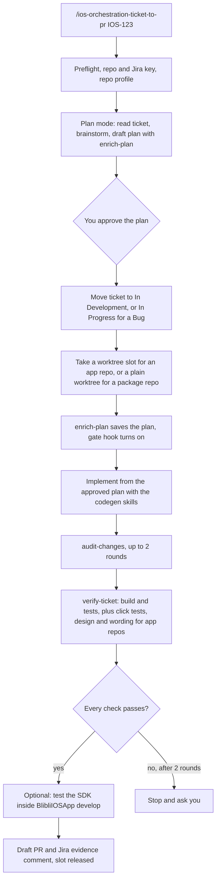

# adit-mobile-orchestration


Ticket-to-PR automation for the Blibli iOS team. A person gives it a Jira ticket and steps in at the plan approval and when something is genuinely blocked. It ends with a verified draft pull request and an evidence comment on the ticket.

There are two versions of it, and this repo describes both.

- The team version is a set of twelve `ios-orchestration-*` skills and a gate hook inside the `mobileapps-ios` plugin of `gdncomm/agent-plugins`. It is in review as [agent-plugins#595](https://github.com/gdncomm/agent-plugins/pull/595) and is not released yet.
- The original version is what this repo ships today: nine `adit-workflow-*` skills, two hooks, a rules block and an installer. It still installs, but its ticket flow can no longer run end to end. See [Status](#status).

The rest of this page describes the team version first, then the original install.

## The flow in two pictures


*Dependency graph of the team version. In review, not released yet.*


*Ticket to PR flow of the team version. In review, not released yet. Regenerate with `python3 scripts/build_flow_diagram.py` and `python3 scripts/build_diagram.py`.*

## What you get in the team version

Start it with `/ios-orchestration-ticket-to-pr IOS-123`. Add `--repo owner/repo` for another repo and `--base branch` for another base branch. Every skill is named `ios-orchestration-` plus the short name below.

| Skill | What it does |
|---|---|
| `ticket-to-pr` | The whole flow: repo and key, plan mode with one approval, worktree, implement with the codegen skills, audit, verify, optional SDK test, draft PR, Jira evidence comment, release. |
| `enrich-plan` | Adds DoD traceability, test cases, click tests, design and wording references and a reviewer pass to a draft plan, then saves it and arms the gate. |
| `verify-ticket` | App repos get lint, build, unit and UI tests, simulator click tests, design and wording checks. Package repos get build and test on the package scheme. It arms the verified marker. |
| `audit-changes` | Runs an audit loop and then a review loop over the current changes and fixes the must-fix and should-fix findings. |
| `sdk-inject-test` | Optional. Tests an SDK change inside the latest `develop` of `BlibliIOSApp`, either by injecting it and building with a warm slot or by printing the steps. It reports compile errors only. |
| `plan-from-ticket` | Turns a ticket into a reviewed plan with risks and test cases. It never implements. |
| `review-open-prs` | Reviews the open PRs of a repo one by one. It comments only, unless you pass `--approve`, and it skips your own PRs. |
| `reply-pr-comments` | Triages unresolved review threads on a PR, fixes the real issues, replies and resolves. |
| `rank-my-tickets` | Ranks your open tickets from easiest to hardest. Read-only. |
| `ticket-status` | Shows the armed gates and the worktree slot table. Read-only. |
| `flow-config` | Shows or changes the saved repo, branch prefix, Jira project, slot counts and repo profile. |
| `flow-doctor` | Full check of tools, `gh` login, Xcode, simulator runtime, settings and which optional tools this client has. The other skills run a quiet cached version of it first. |

The team version works on any iOS repo the team uses. The default is `gdncomm/BlibliIOSApp`, and any `owner/repo` is accepted and checked with `gh repo view`. It runs in Claude Code, in the terminal and in the desktop app. Click tests need the desktop app, because the simulator tool is not available in the terminal. In the terminal they are recorded as needing a manual run.

The gate hook is `ticket_gate.py`. It does nothing until a ticket is armed, and then it blocks `git commit`, `git push` and PR creation until `verify-ticket` passes.

### How the names changed

| Original | Team version |
|---|---|
| the rules block in `CLAUDE.md` | `ios-orchestration-ticket-to-pr` |
| `adit-workflow-plan-enrich` | `ios-orchestration-enrich-plan` |
| `adit-workflow-verify-before-pr` | `ios-orchestration-verify-ticket`, which no longer opens the PR or posts to Jira |
| `adit-workflow-audit-review-code` | `ios-orchestration-audit-changes` |
| `adit-workflow-generate-plan-from-ticket` | `ios-orchestration-plan-from-ticket` |
| `adit-workflow-pr-reply` | `ios-orchestration-reply-pr-comments` |
| `adit-workflow-review-pr-blibli-mobile-ios` | `ios-orchestration-review-open-prs`, for any repo |
| `adit-workflow-check-slot-bliblimobileios` | `ios-orchestration-ticket-status` |
| `adit-workflow-low-hanging-fruit` | `ios-orchestration-rank-my-tickets` |
| `adit-workflow-graphify` | not moved |
| `jira-implement`, `jira-plan`, `jira-develop` | no longer in the marketplace (`jira-implement` was removed in October), so `ticket-to-pr` now does those steps itself |
| new | `flow-config`, `flow-doctor`, `sdk-inject-test` |

## How a ticket runs



[docs/ticket-flow.md](docs/ticket-flow.md) walks through each stage, the blockers, what the gate allows and the gaps found in the first real run.

## Repo profiles

An app repo has an application target, for example `BlibliIOSApp`. It gets a pool of long-lived worktree slots, each with its own DerivedData, Swift packages and simulator. The pool has four slots for `BlibliIOSApp` and one for any other app repo.

A package repo has a `Package.swift` or a library project and no application target, for example `blue-core-ios`. It gets one plain worktree per ticket and is verified by build and test only. If the layout of a repo is not recognised, the flow asks once and saves the answer.

## Settings

The team version keeps your settings in `~/.claude/ios-ticket-flow/config.json`: default repo, branch prefix, Jira project, slot counts and repo profiles. Plans, evidence and gate state live in the same folder. Run `/ios-orchestration-flow-config` to see or change them.

The shared simulator test account for the `uatb` environment is read from `~/.claude/ios-ticket-flow/uatb-account.json` with the keys `email`, `password` and `otp`. It is never stored in a skill or in this repo.

## Try the team version before it is released

Until the PR merges, the `mobileapps-ios` plugin you get from the marketplace does not have these skills. In the terminal you can load the plugin from a checkout of the branch:

```bash
claude --plugin-dir <your agent-plugins checkout>/plugins/mobileapps/ios
```

This route has not been smoke-tested in the terminal yet. The desktop app has no equivalent switch that was tested, so for now it needs the skills linked into `~/.claude/skills` and the gate hook added to `settings.json` by hand.

Remove the original version first if you installed it, otherwise two gate hooks react to the same ticket. `python3 install.py uninstall` does that for an install made by the installer.

## The original version

Everything below this line describes what is in this repo today.

### Install

The repo is private. You need read access to it and, for the full ticket flow, to the `gdncomm/agent-plugins` marketplace.

The quickest way is to ask your agent:

> Install https://github.com/gdncomm-aditya-h/adit-mobile-orchestration by following INSTALL.md in that repo.

To do it yourself:

```bash
git clone git@github.com:gdncomm-aditya-h/adit-mobile-orchestration.git
cd adit-mobile-orchestration
python3 install.py install --dry-run          # lists every change, makes none
python3 install.py install --prefix yourname  # yourname becomes the branch prefix, e.g. yourname/bugfix/IOS-123
python3 install.py doctor                     # checks the result
```

Restart Claude Code or Codex afterwards so it picks up the new skills.

The installer needs only Python 3.8 or newer. It writes a backup of every file it edits under `~/.claude/adit-workflow/backups/`, and running it twice changes nothing the second time. `python3 install.py uninstall` reverses it.

### Skills in this repo

| Skill | What it does | Works on |
|---|---|---|
| [plan-enrich](skills/adit-workflow-plan-enrich/SKILL.md) | Adds DoD traceability, test cases, design and copy references, and a reviewer pass to a draft plan, then saves it. | Claude |
| [verify-before-pr](skills/adit-workflow-verify-before-pr/SKILL.md) | Runs lint, build, unit and UI tests, drives click tests in the simulator, checks design and copy, then opens the draft PR. | Claude |
| [audit-review-code](skills/adit-workflow-audit-review-code/SKILL.md) | Runs an audit loop and then a review loop over your current changes and fixes what they find. | Claude, Codex (experimental) |
| [generate-plan-from-ticket](skills/adit-workflow-generate-plan-from-ticket/SKILL.md) | Turns a ticket into a reviewed plan with risks and test cases. It never implements anything. | Claude, Codex |
| [pr-reply](skills/adit-workflow-pr-reply/SKILL.md) | Triages unresolved review threads, fixes the real issues, replies to the rest and resolves what it can. | Claude, Codex (experimental) |
| [review-pr-blibli-mobile-ios](skills/adit-workflow-review-pr-blibli-mobile-ios/SKILL.md) | Reviews the open PRs in the iOS repo one by one and remembers which commits it already saw. | Claude, Codex (experimental) |
| [check-slot-bliblimobileios](skills/adit-workflow-check-slot-bliblimobileios/SKILL.md) | Prints a read-only health table for the four worktree slots. | Claude, Codex |
| [low-hanging-fruit](skills/adit-workflow-low-hanging-fruit/SKILL.md) | Ranks your open IOS tickets from easiest to hardest. | Claude, Codex |
| [graphify](skills/adit-workflow-graphify/SKILL.md) | Builds a knowledge graph of a codebase and answers architecture questions from it. | Claude, Codex |

Every skill name starts with `adit-workflow-`, so `plan-enrich` is invoked as `/adit-workflow-plan-enrich`.

The two hooks:

- `ticket-flow-gate.py` blocks `git commit`, `git push` and PR creation for an active ticket until `verify-before-pr` has marked it verified. It also refuses `git stash`, `reset`, `rebase` and `merge` during a ticket run.
- `ticket-slots.py` manages a pool of four long-lived worktrees. Each keeps its own DerivedData, Swift packages and simulator, so a new ticket builds incrementally.

### Dependencies of the original version

The skills call skills from other plugins. `install.py` adds these through the `claude plugin` CLI, and `doctor` warns when your version differs from the tested one.

| Plugin | Source | Tested version | Used for |
|---|---|---|---|
| superpowers | anthropics/claude-plugins-official | 7.0.2 | brainstorming in the ticket flow, code-review replies in pr-reply |
| ponytail | DietrichGebert/ponytail | 5.3.3 | audit and review loops |
| ecc | affaan-m/ECC | 2.2.3 | planner and reviewer agents |
| caveman | JuliusBrussee/caveman | 4.0.1 | terse reply mode in pr-reply |
| mobileapps-ios | gdncomm/agent-plugins (private) | 1.9.0 | jira-implement, swift-codegen, swiftui-code-gen, swift-review |
| mobileapps-foundation | gdncomm/agent-plugins (private) | 1.12.0 | create-pr, localization, figma-mcp |

You also need `gh` signed in, and for the ticket flow, Xcode and `swiftlint`. `deps.json` is the machine-readable version of this table. The team version needs `mobileapps-ios` 1.11.0 or newer and `mobileapps-foundation`, and treats superpowers, ponytail and ecc as optional.

### Configure

The branch prefix is set once with `--prefix`. It goes into the rules block, so tickets get branches like `yourname/bugfix/IOS-123`.

The simulator test account used by `verify-before-pr` is not stored in this repo. The installer creates `~/.claude/adit-workflow/uatb-account.json` with placeholder values. Fill in the team's shared `uatb` login there. Skip this if you never run the verify step.

### Update and remove

```bash
git pull
python3 install.py install      # re-copies skills and refreshes the rules block
python3 install.py uninstall    # removes skills, hooks, the gate entry and the rules block
```

Uninstall leaves plugins, your test-account file and your backups alone.

## Layout

```text
install.py        install, uninstall and doctor for the original version
deps.json         plugin sources and tested versions for the original version
skills.json       the original skill list, with Codex support and what each skill calls
skills/           the nine original skills
hooks/            ticket-flow-gate.py and ticket-slots.py of the original version
claude-md/        the rules block written into CLAUDE.md and AGENTS.md by the installer
assets/           diagrams of the team version, built by scripts/build_diagram.py and scripts/build_flow_diagram.py
docs/             ticket flow, design notes, compatibility, troubleshooting
tests/            installer tests
```

## Status

This repo is version 0.1.0 and it is for the Blibli iOS team.

The team version is in review as agent-plugins#595. It has been smoke-tested in the Claude Code desktop app, where an armed branch denied a commit. It has had one real run, ticket IOS-44407, which ended in [BlibliIOSApp#3512](https://github.com/gdncomm/BlibliIOSApp/pull/3512). It has not been tried in the terminal. The first run showed gaps, which are listed in [docs/ticket-flow.md](docs/ticket-flow.md).

The original version still installs, but its ticket flow calls `jira-implement`, `jira-plan` and `jira-develop`. `jira-implement` was removed from `mobileapps-ios` in agent-plugins#493, and the other two are no longer in the marketplace either. Its other skills still work. It gets no new features.

There is no open-source licence yet. Decide on one, and review [NOTICE.md](NOTICE.md), before sharing this wider. Codex support exists only for the original version and is experimental, see [docs/compatibility.md](docs/compatibility.md).

Contributions are welcome through pull requests. [CONTRIBUTING.md](CONTRIBUTING.md) has the steps for the original skills.
