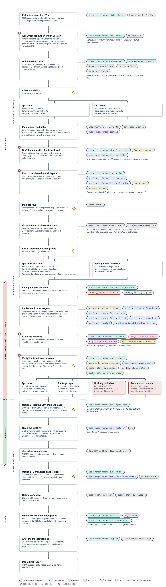
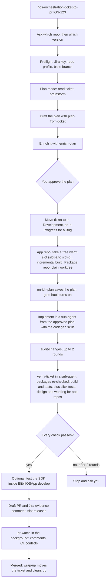
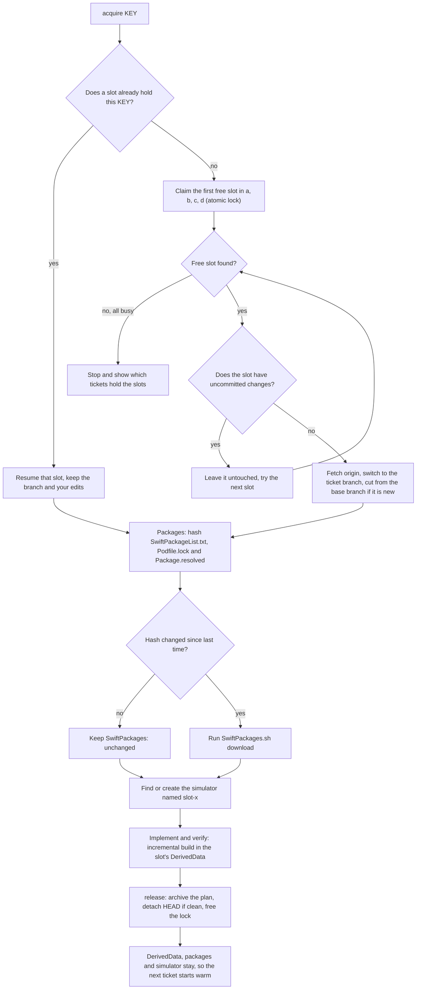

# adit-mobile-orchestration


Ticket-to-PR automation for the Blibli iOS team. A person gives it a Jira ticket and steps in at the repo and version questions, the plan approval and when something is genuinely blocked. It ends with a verified draft pull request and an evidence comment on the ticket.

This repo is a mirror of the `ios-orchestration-*` part of the `mobileapps-ios` plugin in `gdncomm/agent-plugins`, which is in review as [agent-plugins#595](https://github.com/gdncomm/agent-plugins/pull/595) and not released yet. The PR is the source of truth. `skills/ios-orchestration-*`, `scripts/` and `hooks/hooks.json` here are byte-identical copies of the PR's files, and `tools/sync_from_pr.sh --check` proves it. The diagrams, the docs and the tests of the mirror itself belong to this repo. The earlier installer version of this flow (nine `adit-workflow-*` skills, `install.py`, a rules block) was removed in 0.2.0 and is still in the git history.

## The flow in two pictures


*Dependency graph of the flow. In review, not released yet.*



*Ticket to PR flow. In review, not released yet. Regenerate with `python3 tools/build_flow_diagram.py` and `python3 tools/build_diagram.py`.*

## What you get

Start it with `/ios-orchestration-ticket-to-pr IOS-123`. It always asks which repo first and then which version, and the base branch is the ticket's `release/v<Fix Version>` when that branch exists, else the repo's default branch. `--repo owner/repo` and `--base branch` only preselect the recommended answer. Add `--doc` to also publish a Confluence page. Every skill is named `ios-orchestration-` plus the short name below.

| Skill | What it does |
|---|---|
| `ticket-to-pr` | The whole flow: repo and version questions, plan mode (the session is renamed to `<KEY> – <ticket summary>` in the desktop app) with one approval, worktree, implement in a sub-agent with the codegen skills, audit, verify in a sub-agent, optional SDK test, draft PR, Jira evidence comment, release, then the PR watcher. |
| `enrich-plan` | Adds DoD traceability, test cases, click tests, design and wording references and a reviewer pass to a draft plan, then saves it and arms the gate. App repos always get click tests, and changed logic gets unit tests or a stated reason why not. |
| `verify-ticket` | App repos get lint, build, unit and UI tests, simulator click tests, design and wording checks. Package repos get build and test on the package scheme. It arms the verified marker. |
| `audit-changes` | Runs an audit loop and then a review loop over the current changes and fixes the must-fix and should-fix findings. |
| `sdk-inject-test` | Optional. Tests an SDK change inside the latest `develop` of `BlibliIOSApp`, either by injecting it and building with a warm slot or by printing the steps. It reports compile errors only. |
| `plan-from-ticket` | Explores the code with a subagent and drafts a reviewed plan from a ticket: helicopter view, before and after, steps and risks. `ticket-to-pr` uses it as the drafting step in plan mode. It also runs on its own, and it never implements. |
| `review-open-prs` | Reviews the open PRs of a repo one by one. It comments only, unless you pass `--approve`, and it skips your own PRs. |
| `reply-pr-comments` | Triages unresolved review threads on a PR, fixes the real issues, replies and resolves. |
| `rank-my-tickets` | Ranks your open tickets from easiest to hardest. Read-only. |
| `ticket-status` | Shows the armed gates and the worktree slot table. Read-only. |
| `pr-watch` | Babysits the draft PR with a background script (`gh` and `jq`, no model cost while it polls). It wakes the session on merged, closed, conflicts, CI failure, unresolved comments or marked ready, and routes each one. `ticket-to-pr` starts it. |
| `wrap-up` | After the merge: moves the Jira ticket (Bug to Code Review, other types to Dev Testing), releases the slot, clears the gate and archives the plan. |
| `publish-doc` | Puts the ticket context, the plan and the test cases into one Confluence page for QA and links it on the ticket. It asks before publishing, and `ticket-to-pr --doc` runs it. |
| `flow-config` | Shows or changes the saved repo, branch prefix, Jira project, slot counts and repo profile. |
| `flow-doctor` | Full check of tools, `gh` login, Xcode, simulator runtime, settings and which optional tools this client has. The other skills run a quiet cached version of it first. It also lists the plugins the flow calls, read-only. |
| `setup` | One-time setup. Checks the plugins the flow needs, asks per missing plugin, installs the ones you approve with the `claude` CLI and tells you to restart. It never runs during a ticket flow. |

The flow works on any iOS repo the team uses. The default is `gdncomm/BlibliIOSApp`, and any `owner/repo` is accepted and checked with `gh repo view`. It runs in Claude Code, in the terminal and in the desktop app. Click tests need the desktop app, because the simulator tool is not available in the terminal. In the terminal they are recorded as needing a manual run.

The gate hook is `ticket_gate.py`. It does nothing until a ticket is armed, and then it blocks `git commit`, `git push` and PR creation until `verify-ticket` passes. It also requires `--draft` on `gh pr create` (`--draft=false` is denied) and denies marking a PR ready, by `gh pr ready` or by the GraphQL mutation.

### Where the original skills went

| Removed original | Now |
|---|---|
| the rules block in `CLAUDE.md` | `ios-orchestration-ticket-to-pr` |
| `adit-workflow-plan-enrich` | `ios-orchestration-enrich-plan` |
| `adit-workflow-verify-before-pr` | `ios-orchestration-verify-ticket`, which no longer opens the PR or posts to Jira |
| `adit-workflow-audit-review-code` | `ios-orchestration-audit-changes` |
| `adit-workflow-generate-plan-from-ticket` | `ios-orchestration-plan-from-ticket`, now the draft step of the flow, without its old implementation step |
| `adit-workflow-pr-reply` | `ios-orchestration-reply-pr-comments` |
| `adit-workflow-review-pr-blibli-mobile-ios` | `ios-orchestration-review-open-prs`, for any repo |
| `adit-workflow-check-slot-bliblimobileios` | `ios-orchestration-ticket-status` |
| `adit-workflow-low-hanging-fruit` | `ios-orchestration-rank-my-tickets` |
| `adit-workflow-graphify` | not moved |
| `jira-implement`, `jira-plan`, `jira-develop` | no longer in the marketplace (`jira-implement` was removed in October), so `ticket-to-pr` now does those steps itself |
| new | `flow-config`, `flow-doctor`, `setup`, `sdk-inject-test`, `pr-watch`, `wrap-up`, `publish-doc` |

## How a ticket runs



[docs/ticket-flow.md](docs/ticket-flow.md) walks through each stage, the blockers, what the gate allows and the gaps found in the first real run.

## Repo profiles

An app repo has an application target, for example `BlibliIOSApp`. It gets a pool of long-lived worktree slots, each with its own DerivedData, Swift packages and simulator. The pool has four slots (`slot-a` to `slot-d`) for `BlibliIOSApp` and one for any other app repo. See [Slots, warm start and incremental builds](#slots-warm-start-and-incremental-builds).

A package repo has a `Package.swift` or a library project and no application target, for example `blue-core-ios`. It gets one plain worktree per ticket and is verified by build and test only. If the layout of a repo is not recognised, the flow asks once and saves the answer.

## Slots, warm start and incremental builds

A full build of `BlibliIOSApp` is slow, so the flow never makes a fresh checkout for a ticket. It keeps a fixed pool of long-lived git worktrees called slots, and each ticket borrows one. This is done by `ticket_slots.py` (`hooks/ticket-slots.py` in the original version).

| Part | What it means |
|---|---|
| Slot | One git worktree named `slot-a`, `slot-b`, `slot-c` or `slot-d`. `BlibliIOSApp` has four, so four tickets can run at the same time. Other app repos have one (`slot-a`). The size is a setting (`flow-config`). |
| Where | `<parent of your main checkout>/worktrees/`. For `BlibliIOSApp` that folder is used as it is. Other app repos use `worktrees/<repo>/`. |
| Warm start | A slot keeps its own `DerivedData` inside the worktree, its `SwiftPackages` and its own simulator named after the slot. Releasing a slot does not delete any of them, so the next ticket starts warm. |
| Incremental build | Xcode finds the previous build products in the slot's `DerivedData` and recompiles only what changed since the last ticket, not the whole app. |
| Cold start | The first ticket on a slot. Also a slot whose folder you deleted. It does a full build once and is warm after that. |

How a slot is used:



What to know:

- A slot is held from `acquire` until `release`. The flow releases it when the draft PR exists, and `wrap-up` releases it again if it is still held. A crashed session keeps its slot until you run `ticket_slots.py release <KEY or slot letter>`.
- Starting the same ticket again goes back to the slot that holds it, so a resumed ticket keeps its branch and edits.
- The helper never runs `git clean`, `git reset` or `git stash`. Do not run `git clean -fdx` in a slot yourself, because it deletes the warm build and the next ticket starts cold.
- A slot with uncommitted changes is skipped, never reset. If every slot is busy or dirty the flow stops and shows the table. `/ios-orchestration-ticket-status` shows the same table at any time.
- A warm slot is not always a fast one. If the base branch moved a lot, or `SwiftPackageList.txt`, `Podfile.lock` or `Package.resolved` changed, the packages are downloaded again and more of the app recompiles. You never run the download yourself, see [Swift packages, sub-agents and plugin prerequisites](#swift-packages-sub-agents-and-plugin-prerequisites).
- `sdk-inject-test` uses a warm slot too. It puts an SDK worktree into the latest `develop` on a throwaway `inject/*` branch that is always cut fresh from the base, and that branch is never pushed.
- Package repos have no slots: one plain worktree per ticket, no simulator, removed on release when it is clean.

## Swift packages, sub-agents and plugin prerequisites

Swift packages need no manual step. `ticket_slots.py acquire` runs `SwiftPackages.sh download` for the slot when `SwiftPackageList.txt`, `Podfile.lock` or `Package.resolved` changed since the last download, or when `SwiftPackages/` is missing, and it retries once on failure. The check runs after the ticket branch is checked out, so a branch change is covered. It runs again through `ticket_slots.py packages <KEY>` after a sync with `origin/<base>` and before the first build in `verify-ticket`, and it downloads only when those files changed. You are never asked. Only a download that still fails after the retry stops the flow, and it shows the last lines of the output.

`ticket-to-pr` keeps the main session small by using two sub-agents. One writes the code from the saved plan. It never commits, pushes or asks you anything, and it returns the files changed, the tests added, the differences from the plan, or a `BLOCKER:` line. The other runs `verify-ticket` and returns the result table and the evidence paths. The main session keeps the questions, plan mode, Jira, the draft PR and the gate, and it checks each result with `git status` and `ticket_gate.py list` instead of trusting the report. If the `Agent` tool is missing or a sub-agent cannot reach the worktree or the simulator tool, that step runs in the main session and the final report says so. Two things have not been checked in a real run yet: that the gate hook fires for a sub-agent's tool calls (the sub-agent never commits or pushes, so the flow does not depend on it), and that a sub-agent can drive the simulator tool.

`ticket-to-pr` blocks only when `mobileapps-foundation` is missing, because `create-pr`, `localization`, `figma-mcp` and `jira-doc-generator` come from it. `superpowers`, `ponytail` and `ecc` are optional with fallbacks. If both `ponytail` and `ecc` are missing, `audit-changes` has no reviewer. `/ios-orchestration-setup` lists what is missing, asks per plugin, and runs `claude plugin marketplace add` and `claude plugin install` only after a yes. Plugins load at session start, so restart Claude Code afterwards.

## Settings

The flow keeps your settings in `~/.claude/ios-ticket-flow/config.json`: default repo, branch prefix, Jira project, slot counts and repo profiles. Plans, evidence and gate state live in the same folder. Run `/ios-orchestration-flow-config` to see or change them.

The shared simulator test account for the `uatb` environment is read from `~/.claude/ios-ticket-flow/uatb-account.json` with the keys `email`, `password` and `otp`. It is never stored in a skill or in this repo.

## Use this repo

Once the PR is released, get the flow from the `mobileapps-ios` plugin (1.11.0 or newer) and ignore this repo. Until then, in the terminal you can load this repo as a plugin directory:

```bash
claude --plugin-dir <your clone of this repo>
```

Do not enable it next to `mobileapps-ios` 1.11.0 or newer, because two gate hooks would react to the same ticket. If you used the old installer, run its `python3 install.py uninstall` from a checkout of an older commit first. This route has not been smoke-tested in the terminal yet. Run `/ios-orchestration-setup` first on a new machine.

## Keeping the mirror identical

```bash
tools/sync_from_pr.sh           # copy the PR's files into this repo
tools/sync_from_pr.sh --check   # exit 1 if this repo differs from the PR
```

The script clones `SRC_REPO` (default `gdncomm/agent-plugins`) at `SRC_BRANCH` (default the head of the PR) over SSH, or reads a local checkout from `SRC_DIR`. After the PR merges, set `SRC_BRANCH=main`. Never edit the mirrored files here: change the PR, then sync. CI cannot reach the private repo, so run `--check` yourself before you push.

## Layout

```text
skills/ios-orchestration-*   the sixteen skills (mirrored)
scripts/                     doctor, slots, gate, PR watcher and their tests (mirrored)
hooks/hooks.json             the PreToolUse gate registration (mirrored)
.claude-plugin/plugin.json   lets Claude Code load this repo as a plugin directory (not mirrored)
tools/                       sync_from_pr.sh and the two diagram builders
assets/                      diagrams, built by tools/build_diagram.py and tools/build_flow_diagram.py
docs/                        ticket flow, design notes, troubleshooting
tests/                       tests of the mirror script
```

Run the tests with `python3 -m unittest discover -s scripts/tests` and `python3 -m unittest discover -s tests`.

## Status

This repo is version 0.2.0 and it is for the Blibli iOS team.

The flow is in review as agent-plugins#595. It has been smoke-tested in the Claude Code desktop app, where an armed branch denied a commit. It has had one real run, ticket IOS-44407, which ended in [BlibliIOSApp#3512](https://github.com/gdncomm/BlibliIOSApp/pull/3512). It has not been tried in the terminal. The first run showed gaps. The review has since closed three of them (draft PRs enforced, a test target that does not compile needs an override reason, the `uatb` environment is confirmed before login), and [docs/ticket-flow.md](docs/ticket-flow.md) lists what is left. The sub-agent steps, the PR watcher, wrap-up, the Confluence publish and `ios-orchestration-setup` have unit tests or no tests only, and have not run on a real ticket.

There is no open-source licence yet. Decide on one, and review [NOTICE.md](NOTICE.md), before sharing this wider.

Contributions are welcome through pull requests. [CONTRIBUTING.md](CONTRIBUTING.md) has the steps.
