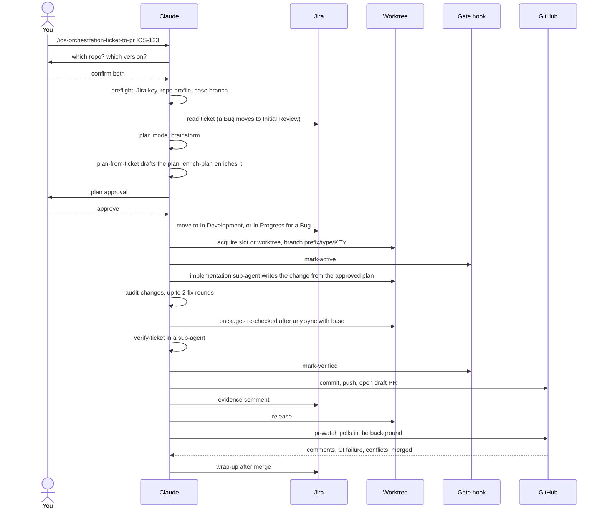

# The ticket flow

This page follows one ticket from start to draft PR. The flow is in review as [agent-plugins#595](https://github.com/gdncomm/agent-plugins/pull/595). The rules live in the entry skill `ios-orchestration-ticket-to-pr`, not in your `CLAUDE.md`, so nothing needs to be written into your global files.

The earlier installer version of this flow called `jira-implement`, `jira-plan` and `jira-develop`, which were removed from `mobileapps-ios`. It was removed from this repo in 0.2.0.

## Who does what

## Stages

### 1. Preflight, repo and ticket

Claude runs a quiet preflight first. It prints nothing when the machine is ready, and prints a blocker when a tool the skill needs is missing. Tool results are cached for 24 hours, so you never have to run `flow-doctor` first. A missing required plugin (`mobileapps-foundation`) points to `setup`, which installs it after a yes. The flow itself never installs anything.

The first thing it does, before anything else runs, is ask which repo you are working on. The recommended answer is the one you pass with `--repo`, else the checkout you are in, else your saved default, else `gdncomm/BlibliIOSApp`, and it asks even when you passed `--repo`. It then settles three more things. The Jira key is the first `[A-Z]+-\d+` in the argument, and if it is missing or ambiguous Claude asks for the ticket URL. The repo profile, app or package, is detected from the files and confirmed with you once if it is not recognised. The base branch comes from a second question, which version the ticket is for. Claude reads the ticket's Fix Version, maps `X.Y.Z` to `release/vX.Y.Z`, and recommends that branch when it exists on `origin`, else the `--base` you passed, else the repo's default branch. A branch that does not exist is refused.

It also detects whether it runs in the desktop app or in the terminal. The terminal has no simulator tool, so click tests become a manual run there.

### 2. Plan mode

Claude enters plan mode and does read-only work. It reads the ticket, compares two or three approaches and picks one. `plan-from-ticket` then explores the code with a subagent, asks only about gaps that block the plan, and writes the draft: decisions and assumptions, a helicopter view, before and after, steps, risks and leftovers. It never implements. `enrich-plan` then adds the rest: DoD traceability, test cases, click test cases for app repos, design and copy references, and a reviewer pass. The only write allowed here is the Jira move to Initial Review for a Bug.

The planned stops are three one-click confirmations: the repo, the version and the plan approval. After you approve, the desktop app switches the session to auto mode. In the terminal you press Shift+Tab.

### 3. Ticket status

The first thing after approval is moving the ticket to its in-work status. The status depends on the issue type. In the IOS workflow a Story, Task or Sub-task has `In Development`, and a Bug has `In Progress` and no `In Development`. Claude reads the available transitions, picks the one that leads to `In Development`, else `In Progress`, and prints one line saying it moved the ticket or why it did not. A move that is not possible does not stop the run.

### 4. Worktree and branch

For an app repo Claude takes a slot with `ticket_slots.py acquire`. `BlibliIOSApp` has four slots and other app repos have one. The helper creates the branch `<prefix>/<type>/<KEY>`, where the type comes from the Jira issue type (`bugfix`, `techdebt`, `chores`, `improvement`, `story` and so on) and the prefix is your saved branch prefix. It also writes the DerivedData setting, downloads Swift packages only when the package list changed, and finds or creates the slot's simulator.

The slots are named `slot-a` to `slot-d` and live on after release, with their DerivedData, packages and simulator, so the next ticket starts warm and builds incrementally. The README section [Slots, warm start and incremental builds](../README.md#slots-warm-start-and-incremental-builds) has the full lifecycle. The Swift packages are downloaded for you when they changed, retried once, and never asked about. See [Swift packages, sub-agents and plugin prerequisites](../README.md#swift-packages-sub-agents-and-plugin-prerequisites).

A package repo gets one plain worktree per ticket, with no simulator. If every slot is busy, Claude stops and shows you which tickets hold them.

`enrich-plan` then saves the approved plan and turns the gate on for this ticket.

### 5. Implement and audit

A sub-agent implements from the one approved plan, so the edits stay out of the main session's context. It never commits, pushes or asks, and the main session checks its report with `git status` and `git diff --stat`. Swift edits go through `swift-codegen`, SwiftUI through `swiftui-code-gen`, new API calls through `add-api`, and tests through `tdd`. `audit-changes` then runs an audit loop and a review loop, fixes the must-fix and should-fix findings, and lists the nice-to-haves it left alone.

### 6. Verify

`verify-ticket` runs in a sub-agent that returns only the result table and the evidence paths. It re-checks the Swift packages before the first build and runs the checks that fit the repo profile. Where it would ask you something, it returns a `BLOCKER:` line and the main session asks.

- An app repo gets lint, build, the unit suites named in the plan, the UI tests named in the plan, click tests in the slot's simulator, a design comparison and a wording check against the copy sheet. The design comparison is advisory and cannot fail the gate alone.
- A package repo gets a build and test on the package scheme, then lint.
- The test target must compile. A target that does not compile is a failed check, never a skipped one. After two fix rounds the gate waits for your written override reason, and the PR carries the label `tests-unverified` and the reason.
- Before any credential is typed, Claude reads the environment name from the app screen, says it, and keeps the screenshot. If it is not `uatb` it switches it. If it cannot switch or find the indicator, it asks you once.
- If nothing can be built, it runs the checks that need no build and waits for your written override reason. The PR then carries the label `build-unverified`.

When every check passes it marks the ticket verified. Two failed fix rounds on lint, build or tests count as a blocker.

### 7. SDK test in the app (optional)

For an SDK or library repo, Claude asks whether to test the change inside the latest `develop` of `BlibliIOSApp`. If you say yes, it injects your worktree into a warm app slot on a throwaway `inject/*` branch and builds the app scheme. If you say no, it prints the steps for you to follow. It only reports compile errors and never fixes app code.

### 8. Draft PR and release

`create-pr` opens the PR as a draft. Claude then posts the PR link, the result table and the evidence as a Jira comment, clears the gate and releases the slot. It never marks the PR ready and never merges. With `--doc` it first runs `publish-doc`, which shows a draft Confluence page (context, plan and test cases) and publishes it only after you say yes.

### 9. Watching the PR

After the release, `ticket-to-pr` starts `pr-watch` in the background. A shell script polls GitHub with `gh` and `jq` and spends no model tokens while it waits. It stops and wakes the session on the first of: merged, closed, merge conflicts, a failed check, unresolved review threads, or the PR marked ready. Comments go to `reply-pr-comments`. A failed check caused by the change is fixed, at most two rounds, and a flaky one is re-run once. Conflicts are synced with `origin/<base>`, and real conflicts stop and ask you. The watcher gives up after eight hours and can be started again with `/ios-orchestration-pr-watch <PR>`.

### 10. After the merge

`wrap-up` runs when the watcher reports a merge. It checks the PR is really merged, then moves the ticket to Code Review for a Bug or Dev Testing for any other type, clears the gate, releases the slot if it is still held, and archives the saved plan.

## What stops the run

Claude stops and asks you when any of these happen:

- the pool of slots is full, or a slot has uncommitted changes
- the simulator login fails, or the app crashes twice in a row
- lint, build or tests still fail after two fix rounds, or no build is possible and there is no override reason yet
- the Swift packages still fail to download after the automatic retry
- the ticket has no usable DoD, or the design or copy sheet it depends on is missing
- the ticket and the code disagree in a way that changes scope
- a required root-cause note for a bug fix is missing
- a tool or service fails: `gh`, Jira, an MCP server, a rejected push
- a secrets file is staged
- the gate hook denies a call and running the missing step does not fix it

Things that are recorded and do not stop the run: a test state that needs a manual run, "no UI test covers this", a difference between design and copy sheet (the sheet wins), a Jira move that is not possible, and a scope change after the plan was enriched.

## What the gate hook allows

While a ticket is armed the hook watches `Bash` and the GitHub PR tools.

| Action | Before verified | After verified |
|---|---|---|
| `git commit`, `git push`, `gh pr create` | denied | allowed |
| `git commit` with files changed since verification | denied | denied |
| PR create through the GitHub tool | denied | allowed as draft only |
| PR merge | denied | denied |
| `gh pr create` without `--draft`, or with `--draft=false` | denied | denied |
| `gh pr ready`, or the GraphQL `markPullRequestReadyForReview`, except `gh pr ready --undo` | denied | denied |
| `git stash`, `reset`, `cherry-pick` | denied | denied |
| `git merge` or `rebase` of `origin/...`, or `--continue` and `--abort` | allowed | allowed |
| any other `git merge` or `rebase` | denied | denied |
| any push or PR from a branch named `inject/*` | denied | denied |

The hook only acts on a branch whose name contains an armed ticket key, and an armed ticket expires after seven days. On any other branch it does nothing, and if it hits an unexpected error it allows the call.

## Known gaps from the first real run

The first real run was ticket IOS-44407, which ended in [BlibliIOSApp#3512](https://github.com/gdncomm/BlibliIOSApp/pull/3512). It produced the right branch, title, labels and a Jira comment, and it showed these gaps.

- The gate allowed `gh pr ready` once verified, and `gh pr create` did not require `--draft`. The PR was marked ready 35 minutes after it was created, and it is not known whether a person or the agent did it. Fixed in the review: the gate now requires `--draft`, denies `--draft=false` and denies marking ready, including through GraphQL.
- The unit tests could not run because the test target does not compile on `develop`. The flow carried on instead of asking for an override reason. Fixed in the review: a test target that does not compile now needs an override reason and the `tests-unverified` label.
- The `uatb` environment was not confirmed before the click tests. Fixed in the review: the environment is read from the screen and confirmed first. No screenshots or recording were attached to the Jira comment although two click tests ran, and that one is still open.
- The PR says the simulator build was unsigned and was ad-hoc signed afterwards. The skill says to use normal signing.
