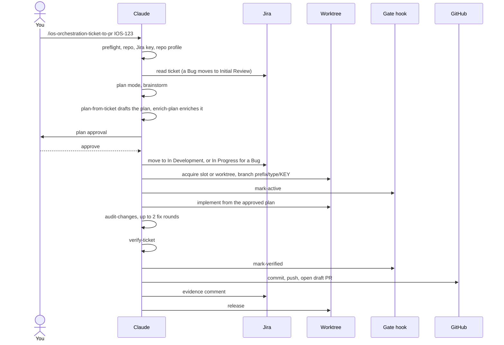

# The ticket flow

This page follows one ticket from start to draft PR in the team version, which is in review as [agent-plugins#595](https://github.com/gdncomm/agent-plugins/pull/595). The rules live in the entry skill `ios-orchestration-ticket-to-pr`, not in your `CLAUDE.md`, so nothing needs to be written into your global files.

The original version of the flow, described by [claude-md/ticket-flow.md](../claude-md/ticket-flow.md), calls `jira-implement`, `jira-plan` and `jira-develop`. Those skills were removed from `mobileapps-ios`, so that flow can no longer run end to end.

## Who does what

## Stages

### 1. Preflight, repo and ticket

Claude runs a quiet preflight first. It prints nothing when the machine is ready, and prints a blocker when a tool the skill needs is missing. Tool results are cached for 24 hours, so you never have to run `flow-doctor` first.

It then settles three things. The repo is the one you pass with `--repo`, else the checkout you are in, else your saved default, and if that is not clear it asks once with `gdncomm/BlibliIOSApp` as the default. The Jira key is the first `[A-Z]+-\d+` in the argument, and if it is missing or ambiguous Claude asks for the ticket URL. The repo profile, app or package, is detected from the files and confirmed with you once if it is not recognised.

It also detects whether it runs in the desktop app or in the terminal. The terminal has no simulator tool, so click tests become a manual run there.

### 2. Plan mode

Claude enters plan mode and does read-only work. It reads the ticket, compares two or three approaches and picks one. `plan-from-ticket` then explores the code with a subagent, asks only about gaps that block the plan, and writes the draft: decisions and assumptions, a helicopter view, before and after, steps, risks and leftovers. It never implements. `enrich-plan` then adds the rest: DoD traceability, test cases, click test cases for app repos, design and copy references, and a reviewer pass. The only write allowed here is the Jira move to Initial Review for a Bug.

The plan approval is the one planned stop. After you approve, the desktop app switches the session to auto mode. In the terminal you press Shift+Tab.

### 3. Ticket status

The first thing after approval is moving the ticket to its in-work status. The status depends on the issue type. In the IOS workflow a Story, Task or Sub-task has `In Development`, and a Bug has `In Progress` and no `In Development`. Claude reads the available transitions, picks the one that leads to `In Development`, else `In Progress`, and prints one line saying it moved the ticket or why it did not. A move that is not possible does not stop the run.

### 4. Worktree and branch

For an app repo Claude takes a slot with `ticket_slots.py acquire`. `BlibliIOSApp` has four slots and other app repos have one. The helper creates the branch `<prefix>/<type>/<KEY>`, where the type comes from the Jira issue type (`bugfix`, `techdebt`, `chores`, `improvement`, `story` and so on) and the prefix is your saved branch prefix. It also writes the DerivedData setting, downloads Swift packages only when the package list changed, and finds or creates the slot's simulator.

A package repo gets one plain worktree per ticket, with no simulator. If every slot is busy, Claude stops and shows you which tickets hold them.

`enrich-plan` then saves the approved plan and turns the gate on for this ticket.

### 5. Implement and audit

Claude implements from the one approved plan. Swift edits go through `swift-codegen`, SwiftUI through `swiftui-code-gen`, new API calls through `add-api`, and tests through `tdd`. `audit-changes` then runs an audit loop and a review loop, fixes the must-fix and should-fix findings, and lists the nice-to-haves it left alone.

### 6. Verify

`verify-ticket` runs the checks that fit the repo profile.

- An app repo gets lint, build, the unit suites named in the plan, the UI tests named in the plan, click tests in the slot's simulator, a design comparison and a wording check against the copy sheet. The design comparison is advisory and cannot fail the gate alone.
- A package repo gets a build and test on the package scheme, then lint.
- If nothing can be built, it runs the checks that need no build and waits for your written override reason. The PR then carries the label `build-unverified`.

When every check passes it marks the ticket verified. Two failed fix rounds on lint, build or tests count as a blocker.

### 7. SDK test in the app (optional)

For an SDK or library repo, Claude asks whether to test the change inside the latest `develop` of `BlibliIOSApp`. If you say yes, it injects your worktree into a warm app slot on a throwaway `inject/*` branch and builds the app scheme. If you say no, it prints the steps for you to follow. It only reports compile errors and never fixes app code.

### 8. Draft PR and release

`create-pr` opens the PR as a draft. Claude then posts the PR link, the result table and the evidence as a Jira comment, clears the gate and releases the slot. It never marks the PR ready and never merges.

## What stops the run

Claude stops and asks you when any of these happen:

- the pool of slots is full, or a slot has uncommitted changes
- the simulator login fails, or the app crashes twice in a row
- lint, build or tests still fail after two fix rounds, or no build is possible and there is no override reason yet
- the ticket has no usable DoD, or the design or copy sheet it depends on is missing
- the ticket and the code disagree in a way that changes scope
- a required root-cause note for a bug fix is missing
- a tool or service fails: `gh`, Jira, an MCP server, a rejected push
- a secrets file is staged
- the gate hook denies a call and running the missing step does not fix it

Things that are recorded and do not stop the run: a test state that needs a manual run, "no UI test covers this", a difference between design and copy sheet (the sheet wins), a Jira move that is not possible, and a scope change after the plan was enriched.

## What the gate hook allows

While a ticket is armed the hook watches `Bash` and the GitHub PR tools.

| Action | Before verified | After verified |
|---|---|---|
| `git commit`, `git push`, `gh pr create` | denied | allowed |
| `git commit` with files changed since verification | denied | denied |
| PR create through the GitHub tool | denied | allowed as draft only |
| PR merge | denied | denied |
| `git stash`, `reset`, `cherry-pick` | denied | denied |
| `git merge` or `rebase` of `origin/...`, or `--continue` and `--abort` | allowed | allowed |
| any other `git merge` or `rebase` | denied | denied |
| any push or PR from a branch named `inject/*` | denied | denied |

The hook only acts on a branch whose name contains an armed ticket key, and an armed ticket expires after seven days. On any other branch it does nothing, and if it hits an unexpected error it allows the call.

## Known gaps from the first real run

The first real run was ticket IOS-44407, which ended in [BlibliIOSApp#3512](https://github.com/gdncomm/BlibliIOSApp/pull/3512). It produced the right branch, title, labels and a Jira comment, and it showed these gaps.

- The gate allows `gh pr ready` once verified, and `gh pr create` does not require `--draft`. "Never mark ready" is only skill text. The PR was marked ready 35 minutes after it was created, and it is not known whether a person or the agent did it.
- The unit tests could not run because the test target does not compile on `develop`. The flow carried on instead of asking for an override reason.
- The `uatb` environment was not confirmed before the click tests, and no screenshots or recording were attached to the Jira comment although two click tests ran.
- The PR says the simulator build was unsigned and was ad-hoc signed afterwards. The skill says to use normal signing.
