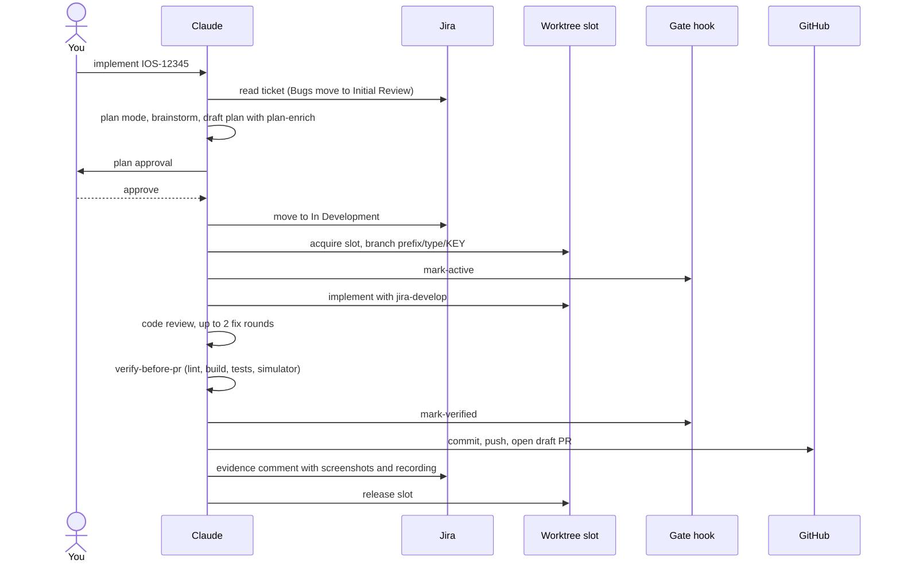

# The ticket flow

This page follows one ticket from start to draft PR. The rules themselves live in [claude-md/ticket-flow.md](../claude-md/ticket-flow.md), which the installer writes into your `CLAUDE.md`. If this page and that file disagree, the rules file wins.

## Who does what

## Stages

### 1. Plan mode

Claude switches the session to plan mode and does read-only work. It reads the ticket, compares two or three approaches, picks one, and drafts a plan with the sections from `adit-workflow-plan-enrich`: DoD traceability, test cases, click test cases, design and copy references, and a reviewer pass. The only write allowed here is the Jira status move for Bugs.

The plan approval is the one planned stop. After you approve, Claude moves the session to auto mode.

### 2. Slot and branch

Claude takes one of four worktree slots with `ticket-slots.py acquire`. The helper creates the branch `<prefix>/<type>/<KEY>`, where the type comes from the Jira issue type (`bugfix`, `techdebt`, `chores`, `improvement`, `story` and so on). It also writes the DerivedData setting, downloads Swift packages only when the package list changed, and finds or creates the slot's simulator.

If all four slots are busy, Claude stops and shows you which tickets hold them.

### 3. Implement and review

`plan-enrich` saves the plan and turns the gate on for this ticket. The team skill `jira-develop` implements it. Claude answers the team skill's approval prompts with the recommended option, except for any option that would override a safety check.

### 4. Verify

`verify-before-pr` runs, in order: lint, build, the unit suites named in the plan, the UI tests named in the plan, click tests in the slot's simulator, a design comparison against the reference, and a wording check against the copy sheet. It also runs `audit-review-code`. When every check passes it marks the ticket verified.

Two failed fix rounds on lint, build or tests count as a blocker.

### 5. Draft PR

`create-pr` opens the PR as a draft. `verify-before-pr` then posts the PR link, screenshots and the screen recording as a Jira comment. Claude clears the gate, releases the slot and reports. It never marks the PR ready and never merges.

## What stops the run

Claude stops and asks you when any of these happen:

- the simulator login fails, or the app crashes twice in a row
- lint, build or tests still fail after two fix rounds
- the ticket has no usable DoD, or the design or copy sheet it depends on is missing
- the ticket and the code disagree in a way that changes scope
- a required root-cause note for a bug fix is missing
- a tool or service fails: `gh`, Jira, an MCP server, a rejected push
- a secrets file is staged
- the gate hook denies a call and running the missing step does not fix it

Things that are recorded and do not stop the run: a test state that needs a manual run, "no UI test covers this", a difference between design and copy sheet (the sheet wins), and a scope change after the plan was enriched.

## What the gate hook allows

While a ticket is active the hook watches `Bash` and the GitHub PR tools.

| Action | Before verified | After verified |
|---|---|---|
| `git commit`, `git push`, `gh pr create` | denied | allowed |
| `git commit` with files changed since verification | denied | denied |
| PR create through the GitHub tool | denied | allowed as draft only |
| PR merge | denied | denied |
| `git stash`, `reset`, `rebase`, `merge`, `cherry-pick` | denied | denied |

The hook only acts on a branch whose name contains an active ticket key. On any other branch it does nothing, and if it hits an unexpected error it allows the call.
